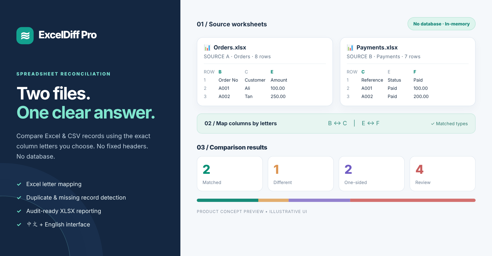

# ExcelDiff Pro

**Excel / CSV Comparison & Reconciliation Studio**  
**Excel / CSV 智能比较与自动对账工具**

[English](#english) · [简体中文](#简体中文) · [Deployment / 部署](docs/DEPLOYMENT.md) · [User Guide / 用户指南](docs/USER_GUIDE.md)

**Python · Streamlit · Pandas · OpenPyXL · No Database · English (default) / 中文**



<sub>Illustrative UI concept / 界面概念预览；实际运行界面请使用 `python -m streamlit run app.py`。</sub>

> **Compare by Excel column letters — not rigid column names.** Upload two XLSX or CSV files, tell the app which columns identify the same record (`B` ↔ `C`) and which values to compare (`E` ↔ `F`), and download a polished, traceable Excel discrepancy report.
>
> **直接按照 Excel 栏位字母比较，不依赖固定 Header。** 上传两份 XLSX / CSV，选择相对应的匹配编号栏位（`B` ↔ `C`）以及比较金额栏位（`E` ↔ `F`），系统自动找出差异并输出可追溯原始行号的 Excel Report。

---

## English

### What is ExcelDiff Pro?

ExcelDiff Pro is a **database-free web tool for comparing and reconciling two spreadsheets**. It is designed for a real business problem: two departments or systems export similar records with different layouts, and someone spends hours manually comparing Order IDs, payments or reference numbers.

**Who benefits?** Small businesses, bookkeepers, finance teams, operations staff, e-commerce sellers, analysts and freelance automation developers. The application uses configurable matching rules instead of assuming all customers share the same Excel headers.

**This is an end-to-end software portfolio project:** separate business-logic engine, in-memory XLSX/CSV import, English / simplified Chinese interface, styled Excel report, JSON mapping presets, CLI automation, automated tests, a Dockerfile and cloud deployment documentation.

### Features

| Feature | How it helps |
|---|---|
| **Upload two spreadsheets** | Accept `.xlsx` and `.csv`, with multiple worksheet selection for XLSX. |
| **Actual A/B/C… column-letter mapping** | No forced schema or specific header names. Choose each file's physical columns independently. |
| **Configurable starting row** | Supports files with one or more heading rows, or no header at all. |
| **Matching key / composite key** | One or two fields, e.g. `Order ID` or `Order ID + Currency`. |
| **Three comparison modes** | Numeric amounts, text/status, or key presence only. |
| **Data-preview safeguards** | Show original row numbers, sample cell values, empty keys, duplicates and cross-file overlap. |
| **Precise number checking** | Decimal arithmetic, optional tolerance and explicit `1,234.56` vs `1.234,56` formatting. |
| **Duplicate handling** | Flag repeated keys by default; opt into Group & SUM for valid split-payment scenarios. |
| **Additional output fields** | Select optional columns from A and B to display next to comparison results. |
| **Download results** | Styled multi-sheet `.xlsx`, plus exception-only `.csv`. |
| **Saved mappings** | Export/import a JSON profile for repeated monthly tasks (no customer file contents). |
| **Privacy-oriented architecture** | No user login, database, external AI API or analytics integration. Files are processed in server session memory. |
| **English (default) / Chinese UI** | Starts in English; switch with **Language / 语言** in the sidebar. |
| **Custom development contact** | Sidebar and bottom-of-page invitation to discuss private deployment, custom rules, integrations and automation via email. |

### Try it in under two minutes

#### 1. Install and run

Python **3.11 or 3.12** is recommended.

```bash
# Clone after publishing to your GitHub, or extract the ZIP package.
cd ExcelDiff-Pro
python -m venv .venv

# macOS / Linux
source .venv/bin/activate
# Windows PowerShell: .venv\Scripts\Activate.ps1

python -m pip install -r requirements.txt
python -m streamlit run app.py
```

Open **http://localhost:8501** and select **Try sample**. The app ships with generated sample data and needs **no API keys or database**.

#### 2. Configure this example

| Rule | Source A / Orders.xlsx | Source B / Payments.xlsx |
|---|---|---|
| Matching key | **B** — Order No | **C** — Reference |
| Numeric value | **E** — Total (RM) | **F** — Paid Amount |
| Data starts | Row 2 | Row 2 |
| Tolerance | 0.01 | — |

The demo intentionally contains missing IDs, mismatched amounts, duplicate orders, empty keys and invalid amounts to demonstrate the exception report.

#### 3. Inspect and download

Review the matching preview and the warnings, click **Run comparison**, then open **Download report**. The exported workbook contains:

- **OVERVIEW** — metrics and how to interpret statuses.
- **ALL RESULTS** — matched and unmatched keys, amounts, differences and original source row numbers.
- **EXCEPTIONS** — only records requiring attention.
- **SETTINGS** — source sheet names, selected column letters and comparison rules for traceability.

**Statuses:** `MATCHED`, `DIFFERENT`, `ONLY IN A`, `ONLY IN B`, `DUPLICATE KEY`, `EMPTY KEY A/B`, `INVALID VALUE`.

### Visual workflow

```text
Source A.xlsx / Source B.xlsx
          |
          v
     Choose worksheets
          |
          v
     Select start rows
          |
          v
  Match columns: B <-> C
 Compare values: E <-> F
          |
          v
 Preview + validate mappings
          |
          v
     Run reconciliation
          |
          v
 Results + exceptions + XLSX
```

### Command-line version

The comparison engine can also be used without Streamlit — ideal for automation scripts or scheduled operations:

```bash
python -m exceldiff \
  examples/sample_orders.xlsx examples/sample_payments.xlsx \
  --sheet-a Orders --sheet-b Payments \
  --key-a B --key-b C \
  --value-a E --value-b F \
  --start-a 2 --start-b 2 \
  --tolerance 0.01 \
  --output comparison_report.xlsx
```

Use a mapping profile instead of reentering rules:

```bash
python -m exceldiff \
  examples/sample_orders.xlsx examples/sample_payments.xlsx \
  --preset examples/sample_mapping_profile.json \
  --output comparison_report.xlsx
```

Display all CLI options:

```bash
python -m exceldiff --help
```

### Structure

```text
ExcelDiff-Pro/
├── app.py                        # Bilingual Streamlit web app
├── assets/theme.css              # Pure CSS loaded via st.html(Path), no external fonts
├── exceldiff/
│   ├── core.py                   # Matching engine + mapping diagnostics
│   ├── io.py                     # Bounded XLSX/CSV reader, column labels
│   ├── report.py                 # Styled XLSX report and safe cell writing
│   ├── sample.py                 # Synthetic data generator
│   ├── presets.py                # Safe, portable JSON mapping profiles
│   ├── cli.py                    # Command-line automation
│   └── __main__.py
├── examples/                     # Sample source files, result and mapping JSON
├── tests/                        # Engine, imports, security, CLI, presets
├── docs/                         # Deployment, user guide and architecture
├── .github/workflows/tests.yml   # GitHub Actions CI
├── .streamlit/config.toml
├── Dockerfile
├── requirements.txt
└── README.md
```

### Testing

```bash
python -m pip install -r requirements-dev.txt
python -m pytest -q
python -m compileall -q app.py exceldiff scripts
python -m scripts.build_demo
```

The test suite covers amounts and decimals, mismatches, missing rows, duplicates, Group & SUM, empty keys, composite keys, CSV encodings, ZIP expansion limits, unsafe formulas in exports, configuration import/export and CLI-generated workbooks.

### Deployment

**Streamlit Community Cloud:** push this repository to GitHub, go to [share.streamlit.io](https://share.streamlit.io), select the repository and set the main entry point to **`app.py`**. The platform reads `requirements.txt`.

**Docker:**

```bash
docker build -t exceldiff-pro .
docker run --rm -p 8501:8501 exceldiff-pro
```

See [the bilingual deployment guide](docs/DEPLOYMENT.md) for full steps and a production checklist.

### Privacy, reliability and limitations

- **No database required**; the app processes inputs in the hosting server's session memory. This does **not** mean that confidential files never leave your computer: they are uploaded to the host server over the network. Select a trusted private deployment for sensitive data.
- Limits: **10 MB/file**, up to **30,000 physical rows** and **100 columns** per worksheet; XLSX decompression is capped. Files with complex formulas, password protection, merged/pivoted shapes or unusual CSV encodings may need preprocessing.
- Matching is **deterministic, not AI-driven**. Incorrect column selections can still produce incorrect conclusions; the UI provides overlap checks and sample previews to help humans verify their rules.
- A physically inserted Excel column changes positions, so **saved JSON mappings must be rechecked** when source layouts change. Leading zeros already removed by Excel formatting cannot be reconstructed automatically.
- The first version compares **one value pair per run** with up to two matching-key columns. This is intentional scope control, not a claim of support for every possible workbook.
- Security-oriented protections are included (file-size checks, read-only XLSX parsing, escaped formulas and no external API calls). Public, commercial or sensitive deployments still require **hosting security review, TLS, appropriate authentication, capacity limits and monitoring**. The app has not undergone independent penetration testing.

### Professional customization / Freelance services

The web app includes an optional **Work With Me** section in the sidebar and below the demo/results. Its email link opens a user's email application with a prepared enquiry subject; **there is no lead database, payment provider, contact form, or tracking**.

If you need **multi-file matching, special invoice or fee rules, scheduled Excel reports, Python / SQL automation, API / ERP integration or a private internal deployment**, please get in touch:

**[greatfoodprefer@gmail.com](mailto:greatfoodprefer@gmail.com?subject=Custom%20automation%20enquiry%20%7C%20ExcelDiff%20Pro)**

The address is configured in `app.py` as `CONTACT_EMAIL`. To reuse the template for your own portfolio, replace it with your own public business contact address before deployment. If you are emailing the developer, describe your use case using synthetic data rather than real financial/customer records.

**Open-source licensing:** The repository's MIT license allows others to use, change and redistribute the published code. Paid work here refers to custom implementation, integrations, business-specific logic and support—not exclusive ownership of the publicly released basic tool.

### Commercial use case / Portfolio pitch

> "I developed an Excel reconciliation application that matches two files despite different layouts, supports configurable column-letter mapping, validates duplicates and errors, and exports audit-friendly discrepancy reports. Built using Python and Streamlit with a tested, database-free core."

---

## 简体中文

### 这个系统是什么？

**ExcelDiff Pro 是一个不用 Database 的 Excel / CSV 比较与自动对账 Web 系统。**

现实中，不同公司的订单 Excel、财务 Excel、付款 Excel 经常采用不一样的格式。比如 Sales 的订单号放在 **B Column**，Payment 的 Reference 放在 **C Column**；销售额放在 **E**，实收金额放在 **F**。人工逐行比较既慢又容易错。

**ExcelDiff Pro 让使用者自己选择这些栏位**，不需要所有 Excel 的标题统一。系统检查每一笔匹配编号是否存在、数值是否相同、有没有遗漏或重复，然后输出 Excel 报告。

适用对象包括：中小企业、Bookkeeper、Account / Finance、E-Commerce、Operations、Data Analyst，以及需要向客户展示 Python 自动化能力的 Freelance Developer。

它不是只写了一个 Python Script，而是完整的 GitHub 作品：**独立比较引擎、双语网页 UI、文件解析、格式化 Excel Report、JSON Mapping Profile、CLI 指令、自动测试、Docker 和部署文件**。

### 系统功能

| 功能 | 说明 |
|---|---|
| **上传两份 Excel / CSV** | 支持 `.xlsx` / `.csv`，多个 Worksheet 可独立选择。 |
| **按 Excel 栏位字母 Mapping** | 直接选择 `A、B、C、E、F`，不需要依赖固定 Header 名称。 |
| **指定资料开始行** | 可处理 Row 1 是标题、标题占多行，或没有标题的文件。 |
| **Matching Key / 组合 Key** | 支持一个编号或两个栏位组合，例如 `Order ID + Currency`。 |
| **三种比较模式** | 金额比较、文字 / Status 比较、只检查编号是否存在。 |
| **自动检查 Mapping 是否可疑** | 预览原始内容、重复编号、空 Key、两份文件的 Key 匹配率。 |
| **金额安全检查** | Decimal 金额计算、可接受差额、不同小数分隔符的明确配置。 |
| **重复 Key** | 默认标记重复，只有明确启用 Group & SUM 才会加总付款。 |
| **选择其他输出栏位** | 可附加显示 Excel A / B 的 Customer、Status 等自选字段。 |
| **导出报告** | 格式化 Excel（4 Sheets），也可下载仅含异常记录的 CSV。 |
| **Mapping Profile** | 保存 / 载入 JSON，下次不需要重新指定所有规则。 |
| **中英双语切换** | 默认 English；左侧 `Language / 语言` 可切换简体中文。 |
| **定制开发联系入口** | 左侧栏和页面底部提供高级功能、Python 自动化与商业系统整合的邮件咨询入口。 |
| **无需数据库** | 不存取 SQL / 外部 AI API，采用内存处理。 |

### 定制开发 / Freelance 服务

ExcelDiff Pro 免费版本用于展示基础 Excel / CSV 对比流程。如果公司需要**多文件对账、专属业务规则、定时 Excel 报告、Python / SQL 自动化、API / ERP 对接或内部部署**，可以通过网页中的 **Work With Me / 定制开发服务** 区块联系开发者。

**联系邮箱：[greatfoodprefer@gmail.com](mailto:greatfoodprefer@gmail.com?subject=ExcelDiff%20Pro%20Custom%20Automation)**

邮件按钮使用系统的 `mailto:`，**不会保存访客邮箱**，也没有自动收集客户资料。邮箱常量 `CONTACT_EMAIL` 在 `app.py` 中可修改。建议潜在客户用假数据或脱敏示例说明需求，不要通过普通邮件发送银行明细等机密资料。

**开源说明：** 当前项目使用 MIT License，公开代码可由其他人自由使用和修改。可收费的是客户专属开发、整合、部署和维护，而不是宣称基础代码只有付费才能使用。


### 三分钟开始使用

#### 1. 本地安装

建议安装 Python **3.11 或 3.12**：

```bash
cd ExcelDiff-Pro
python -m venv .venv

# Windows PowerShell：.venv\Scripts\Activate.ps1
# macOS / Linux：
source .venv/bin/activate

python -m pip install -r requirements.txt
python -m streamlit run app.py
```

打开 **http://localhost:8501**，点击 **试用示例**，不需要自己的 Excel 就能测试。

#### 2. 配置 Excel Mapping

用内建示例：

| 设置 | Excel A / Orders | Excel B / Payments |
|---|---|---|
| Matching Key（编号） | **B** — Order No | **C** — Reference |
| Comparison Value（金額） | **E** — Total (RM) | **F** — Paid Amount |
| Data Start Row | Row 2 | Row 2 |
| Allowed Difference | 0.01 | — |

系统会在 Dropdown 里显示实际 Excel Column Letter、相邻标题和样本资料，选错时可以立即观察。接着检查 **Key 匹配率、空值、重复行、金额无效数据**，确认规则没有问题再执行比较。

#### 3. 查看和下载结果

点击 **开始比较**，可以看到：

- **一致（MATCHED）**：两边都存在，所选金额在误差范围内。
- **不一致（DIFFERENT）**：找到了相同编号，但金额不一样。
- **仅在 A / B（ONLY IN A/B）**：某边缺少该笔记录。
- **重复 Key（DUPLICATE KEY）**：编号重复，需要人工检查。
- **空 Key（EMPTY KEY A/B）**：缺少匹配编号，不进行错误匹配。
- **金额无效（INVALID VALUE）**：不能安全转换成数字。

可以下载 `ExcelDiff_Comparison_Report.xlsx`，内含：

1. `OVERVIEW`：数量统计、状态说明。
2. `ALL RESULTS`：所有匹配结果、原始 Excel Row、数值和差额。
3. `EXCEPTIONS`：仅异常记录。
4. `SETTINGS`：所选 Column Letter、Sheet、起始行和其他比较规则。

也支持下载 `ExcelDiff_Exceptions.csv`。

### Mapping 真的能解决不同 Excel Format 吗？

**能解决不同 Header、Column 顺序和基本表格结构的问题，但不是任意格式自动通吃。**

假设公司 A 用 `Order No / Total`，公司 B 用 `Reference / Paid Amount`，User 自己指定 `B ↔ C` 和 `E ↔ F`。程序不会猜业务意义，所以需先预览，再看匹配率。

如果下个月公司在 Excel 前面插入了新栏位，原本的 `B` 可能变成 `C`。JSON Mapping Profile **不会自动理解业务字段已经移动**，必须重新检查。合并格、交叉表、PDF Invoice、公式重新计算等复杂数据布局需要之后开发适配器。

### 为什么没有 Database？

这个应用是即时的 **Upload → Mapping → Compare → Download** 流程。用户不需要账号、历史记录或储存任务，因此没有必要先用 MySQL、PostgreSQL。

Excel 文件会被上传到部署该应用的**服务器内存**，处理完成后报告也从内存下载；项目没有主动将原文件写入 SQL 数据库或磁盘。但这**不代表资料完全不离开电脑**。如果上传公司机密，建议部署在内部服务器，并配置 HTTPS 和访问权限。

### 两种部署方式

**GitHub + Streamlit Community Cloud**：把本项目推上 GitHub 后，打开 [share.streamlit.io](https://share.streamlit.io)，选择 Repository，Main file path 指定 `app.py`。适合作为作品集 Demo。

**Docker**：

```bash
docker build -t exceldiff-pro .
docker run --rm -p 8501:8501 exceldiff-pro
```

如要开放给真正客户处理敏感 Excel，应另外进行安全评估、服务器监控、TLS、认证及资源限制。具体步骤请查看 [双语部署指引](docs/DEPLOYMENT.md)。

### CLI 指令自动运行

```bash
python -m exceldiff \
  examples/sample_orders.xlsx examples/sample_payments.xlsx \
  --sheet-a Orders --sheet-b Payments \
  --key-a B --key-b C \
  --value-a E --value-b F \
  --output comparison_report.xlsx
```

也可透过 `--preset examples/sample_mapping_profile.json` 载入保存好的 Mapping。适合之后扩展为 Batch Script 或排程。

### 测试与技术架构

```bash
python -m pip install -r requirements-dev.txt
python -m pytest -q
python -m scripts.build_demo
```

- `app.py` — Streamlit 双语 Web UI。
- `exceldiff/core.py` — Comparison Engine（Key Matching、Decimal、重复检查、异常分类）。
- `exceldiff/io.py` — Excel / CSV 安全读取及 Column Preview。
- `exceldiff/report.py` — Excel 报告格式与 Formula Injection Protection。
- `exceldiff/presets.py` — Mapping JSON 储存与载入。
- `exceldiff/cli.py` — CLI 指令版本。
- `tests/` — 自动化测试。
- `docs/` — 用户使用指南、部署及架构说明。

详情请查看 [系统架构与安全说明](docs/ARCHITECTURE.md)、[完整中英用户指南](docs/USER_GUIDE.md)。

### 已知限制与后续方向

目前仅支持 `.xlsx`、`.csv`；每份文件上限 10 MB，单个 Sheet 最多 30,000 行及 100 栏。暂不支持 XLS、加密 Excel、PDF OCR、自动汇率转换。每次比较一组金额或文字栏位对，支持最多两个匹配编号栏位。

后续可以扩展多组 Value Comparison、复杂 Excel 模板适配、不同格式的 PDF Invoice Parsing、上传之前的格式自动检测。**核心功能先做好，才是最能让客户相信作品可以解决实际业务问题的方式。**

### Freelancer Portfolio 描述范本

> 我开发了一套 Python Excel 自动对账系统，让用户上传两份不同格式的 Excel，自行选择 Column Letter 进行匹配和差异比较。它能识别金额不同、缺少记录、重复编号和无效数据，并导出带原始行号的 Excel 报告。系统支持中英双语、保存 Mapping、CLI 自动化、单元测试及 Docker 部署，不需要数据库。

---

## License / 授权

Released under the [MIT License](LICENSE). You may adapt and deploy the source code under the terms of that license.  
项目采用 [MIT License](LICENSE)，可按许可证条款修改和使用。

**Disclaimer / 免责声明：** Check uploaded files, column positions and sample matches before making financial or operational decisions. This is a reference implementation and has not been independently security-audited. / 在根据结果进行财务或业务决定前，请重新确认来源、栏位、格式与样本数据。本项目属于参考实现，未经过第三方独立安全审计。
